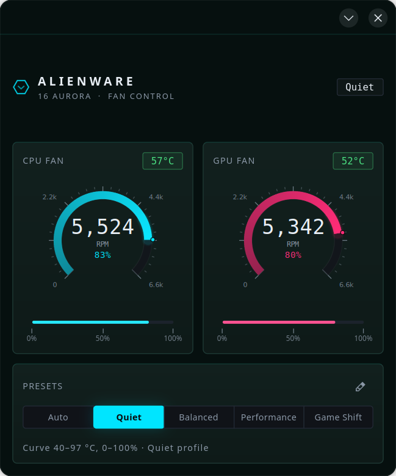
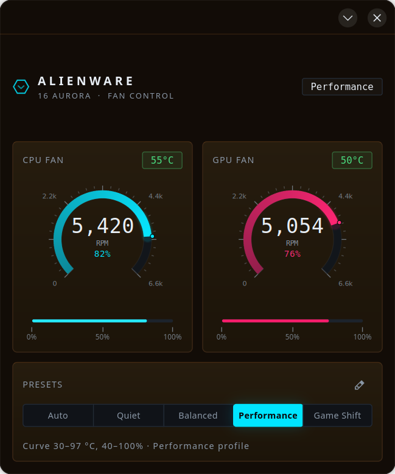
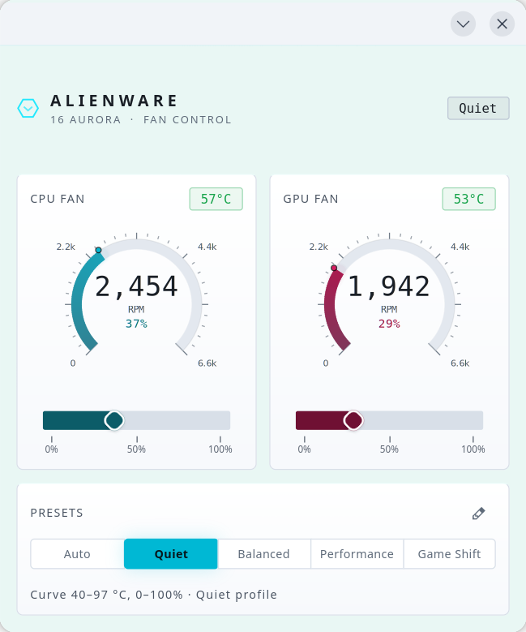
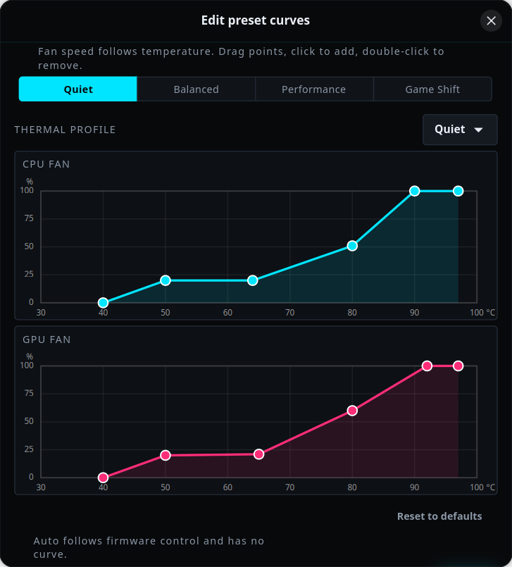

# Alienware 16X Aurora Fan Control for Linux

A fan speed controller for the Alienware 16X Aurora (AC16251) on Linux,
achieved through reverse engineering of the ACPI/WMI interface.



The chassis tint follows the selected preset — Quiet, Balanced, Performance
and Game Shift each get their own surface colour. Gauges and slider fills
brighten with fan speed while keeping the CPU cyan / GPU magenta identity:



The interface follows the system light/dark appearance; every preset tint,
gauge, chart and the curve editor has a light variant:



Each preset is a temperature → fan speed curve per fan. Curves are edited by
dragging points on a chart:



## This fork

Forked from [Hugo2049/alienware-16x-fan-control](https://github.com/Hugo2049/alienware-16x-fan-control),
which contains the original ACPI reverse engineering and protocol discovery.
Licensed under GPL-2.0, same as upstream. All upstream credits below still apply.

Changes in this fork:

- Ubuntu/Debian support with an idempotent `install.sh`: dependencies,
  `acpi_call` boot loading, a scoped NOPASSWD sudoers rule for the helper, and
  a desktop entry.
- Sensor discovery by hwmon name instead of hardcoded indices; CPU/GPU
  temperatures and both fan tachometers come from `alienware_wmi`.
- Per-preset temperature → fan curves, edited on a draggable chart
  (`curve_editor.py`) and persisted to
  `~/.config/alienware-16x-fan-control/presets.json`.
- A 2 s enforcement loop with 3-point hysteresis, a 90 °C full-speed safety
  override, and automatic hand-back to firmware control on exit.
- Single-instance behaviour: launching again focuses the existing window.
- Alienware "Legend" theme (`style.css`) with light and dark variants that
  follow the system appearance, per-preset chassis tints, gauges and sliders
  that brighten with fan speed, and slider positions that mirror actual RPM.
- Hardened helper: argument validation, ACPI error surfacing, and null-byte
  safe result parsing.

## Hardware
- Machine: Alienware 16X Aurora AC16251 / 16 Aurora AC16250
- CPU: Intel Core Ultra 9 275HX
- GPU: NVIDIA GeForce RTX 5070 / 5060 Laptop
- Tested on: Arch Linux kernel 6.18.24-1-lts, Ubuntu 26.04 kernel 7.0

## How it works

Dell/Alienware exposes fan control through a proprietary WMI interface
(AWCCWmiMethodFunction) implemented in ACPI SSDT table AWCCTABL.

By decompiling the ACPI tables and reverse engineering the WMAX method,
we discovered the following protocol:

### Fan Control Commands (via /proc/acpi/call)

CPU fan speed (0-100%):
echo '\_SB.AMWW.WMAX 0 0x15 {0x02,0x32,SPEED,0x00}' > /proc/acpi/call

GPU fan speed (0-100%):
echo '\_SB.AMWW.WMAX 0 0x15 {0x02,0x33,SPEED,0x00}' > /proc/acpi/call

Thermal profiles:
echo '\_SB.AMWW.WMAX 0 0x15 {0x01,0xA0,0x00,0x00}' > /proc/acpi/call  # Balanced
echo '\_SB.AMWW.WMAX 0 0x15 {0x01,0xA1,0x00,0x00}' > /proc/acpi/call  # Performance
echo '\_SB.AMWW.WMAX 0 0x15 {0x01,0xA3,0x00,0x00}' > /proc/acpi/call  # Quiet
echo '\_SB.AMWW.WMAX 0 0x15 {0x01,0xAB,0x00,0x00}' > /proc/acpi/call  # Game Shift

Where SPEED is a hex value from 0x00 (0%) to 0x64 (100%).

### Fan IDs
- 0x32 = CPU fan
- 0x33 = GPU fan

## Dependencies

Ubuntu / Debian:
sudo apt install python3-gi python3-gi-cairo gir1.2-gtk-4.0 gir1.2-adw-1 acpi-call-dkms

Arch Linux:
sudo pacman -S acpi_call-lts python-gobject gtk4 libadwaita

Load module:
sudo modprobe acpi_call

Auto-load on boot:
echo 'acpi_call' | sudo tee /etc/modules-load.d/acpi_call.conf

## Installation

Ubuntu / Debian (recommended):

git clone https://github.com/Hugo2049/alienware-16x-fan-control
cd alienware-16x-fan-control
sudo ./install.sh

The installer installs the GTK4/libadwaita dependencies, loads `acpi_call`
and enables it at boot, grants passwordless sudo for the helper only, and
adds a "Fan Control" entry to the application menu.

Arch Linux:

sudo pacman -S acpi_call-lts python-gobject gtk4 libadwaita
sudo modprobe acpi_call
echo 'acpi_call' | sudo tee /etc/modules-load.d/acpi_call.conf
chmod +x fan_helper.sh

Add sudoers rule:

echo "$USER ALL=(ALL) NOPASSWD: $(pwd)/fan_helper.sh" | sudo tee /etc/sudoers.d/fancontroller
sudo chmod 440 /etc/sudoers.d/fancontroller

Run:

python3 fan_control.py

The app is single-instance: launching it again (terminal or app menu) focuses
the existing window instead of opening a second copy.

## CLI Usage

sudo ./fan_helper.sh cpu 75
sudo ./fan_helper.sh gpu 50
sudo ./fan_helper.sh both 80 60
sudo ./fan_helper.sh profile performance

## Presets

Each preset is a pair of temperature→fan curves (CPU and GPU) plus a
firmware thermal profile. Selecting a preset hands the fans to the curve:
temperatures are sampled every 2 seconds and fan speed is interpolated
between the points you draw. Hover a button for a summary, or click the
pencil icon next to the "Presets" heading to open the curve editor
(drag points, click to add, double-click to remove).

The last active preset is remembered in
`~/.config/alienware-16x-fan-control/state.json` and re-applied when the app
starts again, including its curve. Auto is remembered too and performs no
writes.

Edits are saved to `~/.config/alienware-16x-fan-control/presets.json`:

```json
{
  "balanced": {
    "profile": "balanced",
    "cpu_curve": [[35, 25], [50, 35], [65, 55], [80, 80], [92, 100]],
    "gpu_curve": [[35, 25], [50, 35], [65, 55], [80, 80], [92, 100]]
  }
}
```

Each curve point is `[temperature °C, fan speed %]`, sorted by temperature
(30–100 °C, up to 8 points). `profile` is one of `quiet`, `balanced`,
`performance`, `gameshift`.

Safety behaviour:

- at 90 °C or above, both fans are forced to 100% regardless of the curve;
- speeds are only rewritten when the target moves by 3 points, so the EC is
  not hammered between samples;
- closing the app (or selecting Auto) returns the fans to firmware control;
- Auto has no curve and always follows firmware.

Old configs using fixed `"cpu": 50, "gpu": 50` values are migrated to a flat
curve at that speed.

## Discovery Method

1. Dumped ACPI tables with acpidump
2. Decompiled SSDT tables with iasl
3. Found AWCCTABL SSDT containing AWCCWmiMethodFunction implementation
4. Reverse engineered WMAX method and AX24/AX26 sub-functions
5. Identified EC register writes via ECW1(0x21, speed) and ECW1(0x39, fan_id)
6. Confirmed via acpi_call kernel module

## Credits

Developed by Hugo (Hugo2049) with assistance from Claude (Anthropic).
The reverse engineering methodology, ACPI analysis, and protocol discovery
were worked out collaboratively through an iterative process of dumping
tables, reading ASL source, probing WMI interfaces on Windows, and
testing on Linux via acpi_call.

Claude: https://claude.ai
Anthropic: https://anthropic.com

## License

GPL-2.0 — see [LICENSE](LICENSE). This fork keeps the upstream license.
